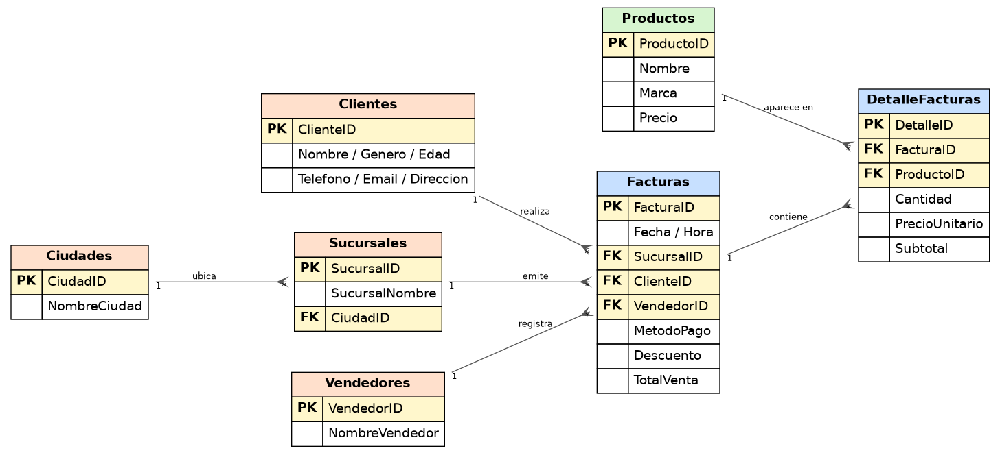

# TechCore — Análisis de ventas y dashboard en Power BI

Proyecto Integrador del **Módulo 3 — Data Analytics (Henry)**.

**TechCore**, una cadena minorista de computadores con presencia en 4 ciudades, contrató a la consultora *DataVision Analytics* para centralizar y analizar sus ventas. El proyecto transforma **30,307 facturas crudas** en un modelo relacional y un **dashboard interactivo en Power BI** con conclusiones estratégicas.

## Fases del proyecto

| Avance | Herramienta | Qué se hizo |
|--------|-------------|-------------|
| 1. Limpieza y transformación | Power Query | Eliminación de 307 duplicados, corrección de 10 marcas mal escritas, normalización de ciudades y sucursales (13 variantes → 6), imputación de nulos, tipos de datos y columnas de fecha derivadas. |
| 2. Modelo relacional | Python (pandas) | Unpivot de formato ancho a largo y construcción de un **modelo estrella** (Facturas, DetalleFacturas, Productos, Clientes, Sucursales, Ciudades, Vendedores) con validación de integridad referencial. |
| 3. Dashboard | Power BI + DAX | Medidas DAX, KPIs de ventas, análisis por ciudad, marca, cliente y tiempo; conclusiones y recomendaciones. |
| 4. Seguridad | Power BI | **Row-Level Security (RLS)** por usuario/ciudad. |



## Hallazgos principales

- **$456,491 millones** facturados en 30,000 ventas (2014–2025), ticket promedio de $15.2 M.
- **Medellín (44.7%) y Bogotá (30.6%)** concentran el 75% de las ventas.
- **Lenovo** lidera con 25.2%; las 4 primeras marcas suman el 81% del total.
- Recomendaciones accionables por plaza, marca y segmento de clientes (ver `docs/Conclusiones_Recomendaciones.pdf`).

## Estructura

```
├── powerbi/
│   ├── Avance_1_Limpieza_Transformacion.pbix
│   └── Avance_3_Dashboard_PowerBI.pbix     # Dashboard final
├── notebooks/Avance_2_Modelo_Relacional.ipynb
├── data/          # ventas.csv (crudo), modeloVentas.xlsx (modelo), Usuarios.xlsx (RLS)
├── docs/          # README técnico y conclusiones (PDF)
└── images/
```

## Tecnologías

Power BI Desktop · Power Query (M) · DAX · Row-Level Security · Python (pandas) · Excel

## Cómo verlo

Descarga `powerbi/Avance_3_Dashboard_PowerBI.pbix` y ábrelo con [Power BI Desktop](https://powerbi.microsoft.com/desktop/) (gratuito).

---
**Autor:** César Montes · [GitHub](https://github.com/czr46)
